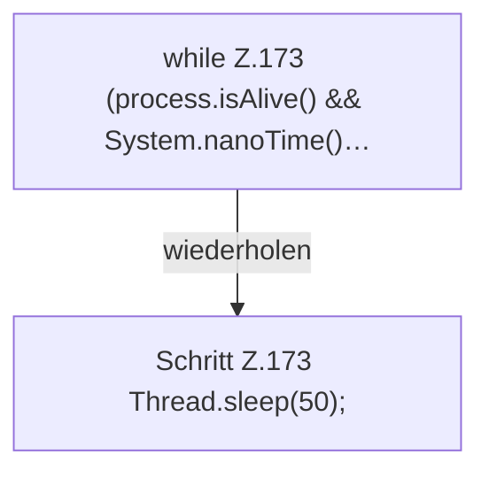

[[00 Start]] › [[Tests]] › [[LifecycleRobustnessTest]] › [[LifecycleRobustnessTest.Teil1]] › [[LifecycleRobustnessTest.stopSendsStopWhenStartupNeverBecomesReadyAndThenKills]] › [[LifecycleRobustnessTest.stopSendsStopWhenStartupNeverBecomesReadyAndThenKills.Teil2]]

# LifecycleRobustnessTest.stopSendsStopWhenStartupNeverBecomesReadyAndThenKills.Teil2

- Fortsetzung von `LifecycleRobustnessTest.stopSendsStopWhenStartupNeverBecomesReadyAndThenKills`, Quellreihenfolge.
