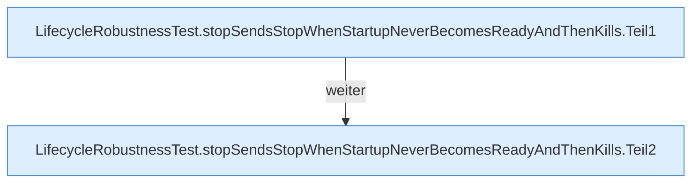

[[00 Start]] › [[Tests]] › [[LifecycleRobustnessTest]] › [[LifecycleRobustnessTest.Teil1]] › [[LifecycleRobustnessTest.stopSendsStopWhenStartupNeverBecomesReadyAndThenKills]]

# LifecycleRobustnessTest.stopSendsStopWhenStartupNeverBecomesReadyAndThenKills

`LifecycleRobustnessTest.stopSendsStopWhenStartupNeverBecomesReadyAndThenKills()` [src/test/java/de/aichele/childlauncher/LifecycleRobustnessTest.java:160–175](https://github.com/Sciddie/minecraft-serverhoster-plugin/blob/95b02b953b0b4c23673e900e021a7c3c844aa37d/src/test/java/de/aichele/childlauncher/LifecycleRobustnessTest.java#L160-L175)



```knoten
LifecycleRobustnessTest.stopSendsStopWhenStartupNeverBecomesReadyAndThenKills.Teil1
  Abschnitt 1 dieses Ablaufs, in Quellreihenfolge.
LifecycleRobustnessTest.stopSendsStopWhenStartupNeverBecomesReadyAndThenKills.Teil2
  Abschnitt 2 dieses Ablaufs, in Quellreihenfolge.
```

- `stopSendsStopWhenStartupNeverBecomesReadyAndThenKills` in `src/test/java/de/aichele/childlauncher/LifecycleRobustnessTest.java`
- Auslöser: Test
