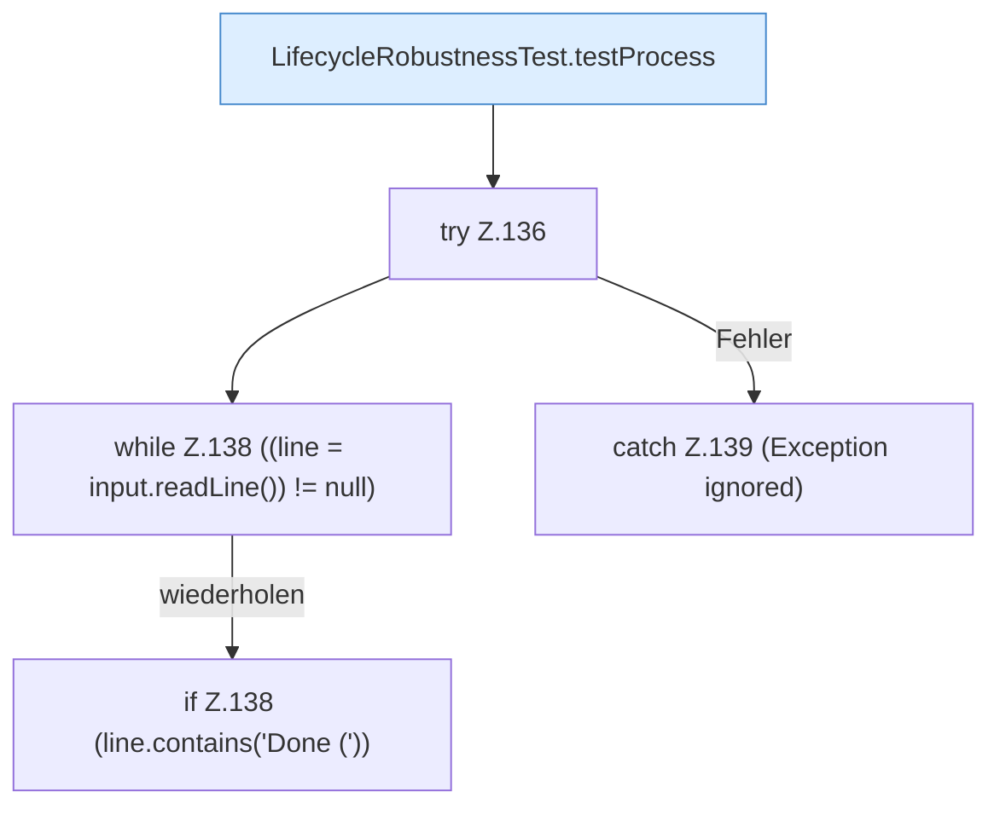

[[00 Start]] › [[Tests]] › [[LifecycleRobustnessTest]] › [[LifecycleRobustnessTest.Teil1]] › [[LifecycleRobustnessTest.stopWaitsUntilReadyBeforeSendingStop]] › [[LifecycleRobustnessTest.stopWaitsUntilReadyBeforeSendingStop.Teil1]]

# LifecycleRobustnessTest.stopWaitsUntilReadyBeforeSendingStop.Teil1



```knoten
LifecycleRobustnessTest.testProcess
  Ein Schritt in einem [[Glossar#Probelauf|Probelauf]]. Er gehört nicht zum laufenden Server. Prüft `testProcess`. Nur Test.
try Z.136
  Zeile 136: Versuch. Der Fehlerpfad geht in catch.
while Z.138 ((line = input.readLine()) != null)
  Zeile 138: Schleife `((line = input.readLine()) != null)`.
if Z.138 (line.contains('Done ('))
  Zeile 138: prüft `(line.contains('Done ('))`.
catch Z.139 (Exception ignored)
  Zeile 139: fängt (Exception ignored).
```

> [!knoten]- Was die Blöcke tun
> - **LifecycleRobustnessTest.testProcess**: Ein Schritt in einem [[Glossar#Probelauf|Probelauf]]. Er gehört nicht zum laufenden Server. Prüft `testProcess`. Nur Test.
> - **try Z.136**: Zeile 136: Versuch. Der Fehlerpfad geht in catch.
> - **while Z.138 ((line = input.readLine()) != null)**: Zeile 138: Schleife `((line = input.readLine()) != null)`.
> - **if Z.138 (line.contains('Done ('))**: Zeile 138: prüft `(line.contains('Done ('))`.
> - **catch Z.139 (Exception ignored)**: Zeile 139: fängt (Exception ignored).

- Ein weiterer Abschnitt derselben Übersicht.
- Fortsetzung von `LifecycleRobustnessTest.stopWaitsUntilReadyBeforeSendingStop`.
