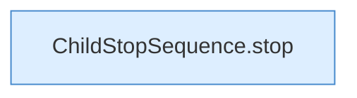

[[00 Start]] › [[Tests]] › [[LifecycleRobustnessTest]] › [[LifecycleRobustnessTest.Teil1]] › [[LifecycleRobustnessTest.stopWaitsUntilReadyBeforeSendingStop]] › [[LifecycleRobustnessTest.stopWaitsUntilReadyBeforeSendingStop.Teil2]]

# LifecycleRobustnessTest.stopWaitsUntilReadyBeforeSendingStop.Teil2



```knoten
ChildStopSequence.stop
  Stoppt `stop`. Ruft `signal`.
```

- Fortsetzung von `LifecycleRobustnessTest.stopWaitsUntilReadyBeforeSendingStop`, Quellreihenfolge.
