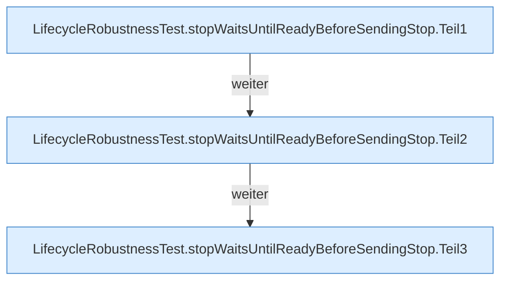

[[00 Start]] › [[Tests]] › [[LifecycleRobustnessTest]] › [[LifecycleRobustnessTest.Teil1]] › [[LifecycleRobustnessTest.stopWaitsUntilReadyBeforeSendingStop]]

# LifecycleRobustnessTest.stopWaitsUntilReadyBeforeSendingStop

`LifecycleRobustnessTest.stopWaitsUntilReadyBeforeSendingStop()` [src/test/java/de/aichele/childlauncher/LifecycleRobustnessTest.java:131–158](https://github.com/Sciddie/minecraft-serverhoster-plugin/blob/95b02b953b0b4c23673e900e021a7c3c844aa37d/src/test/java/de/aichele/childlauncher/LifecycleRobustnessTest.java#L131-L158)



```knoten
LifecycleRobustnessTest.stopWaitsUntilReadyBeforeSendingStop.Teil1
  Ein weiterer Abschnitt derselben Übersicht. Abschnitt 1 dieses Ablaufs, in Quellreihenfolge.
LifecycleRobustnessTest.stopWaitsUntilReadyBeforeSendingStop.Teil2
  Ein weiterer Abschnitt derselben Übersicht. Abschnitt 2 dieses Ablaufs, in Quellreihenfolge.
LifecycleRobustnessTest.stopWaitsUntilReadyBeforeSendingStop.Teil3
  Ein weiterer Abschnitt derselben Übersicht. Abschnitt 3 dieses Ablaufs, in Quellreihenfolge.
```

> [!knoten]- Was die Blöcke tun
> - **LifecycleRobustnessTest.stopWaitsUntilReadyBeforeSendingStop.Teil1**: Ein weiterer Abschnitt derselben Übersicht. Abschnitt 1 dieses Ablaufs, in Quellreihenfolge.
> - **LifecycleRobustnessTest.stopWaitsUntilReadyBeforeSendingStop.Teil2**: Ein weiterer Abschnitt derselben Übersicht. Abschnitt 2 dieses Ablaufs, in Quellreihenfolge.
> - **LifecycleRobustnessTest.stopWaitsUntilReadyBeforeSendingStop.Teil3**: Ein weiterer Abschnitt derselben Übersicht. Abschnitt 3 dieses Ablaufs, in Quellreihenfolge.

- Ein Schritt in einem [[Glossar#Probelauf|Probelauf]]. Er gehört nicht zum laufenden Server.
- `stopWaitsUntilReadyBeforeSendingStop` in `src/test/java/de/aichele/childlauncher/LifecycleRobustnessTest.java`
- Das ist ein Probelauf, kein Teil des laufenden Servers.
