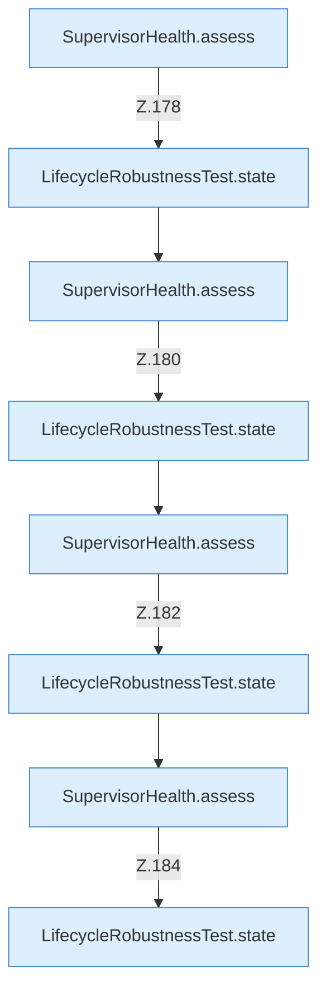

[[00 Start]] › [[Tests]] › [[LifecycleRobustnessTest]] › [[LifecycleRobustnessTest.Teil2]] › [[LifecycleRobustnessTest.supervisorDoesNotRestartDuringLaunchStopOrQueuedRestart]] › [[LifecycleRobustnessTest.supervisorDoesNotRestartDuringLaunchStopOrQueuedRestart.Teil1]]

# LifecycleRobustnessTest.supervisorDoesNotRestartDuringLaunchStopOrQueuedRestart.Teil1

- Fortsetzung von `LifecycleRobustnessTest.supervisorDoesNotRestartDuringLaunchStopOrQueuedRestart`, Quellreihenfolge.
