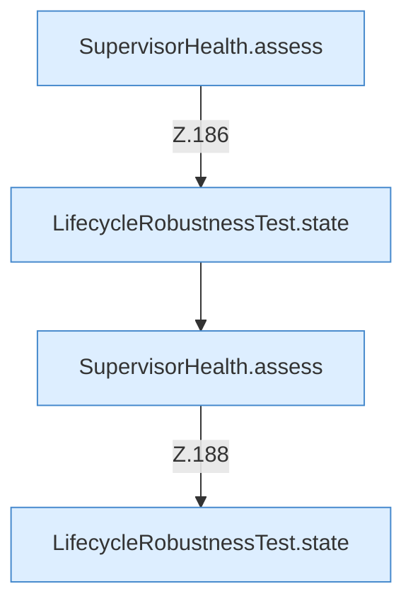

[[00 Start]] › [[Tests]] › [[LifecycleRobustnessTest]] › [[LifecycleRobustnessTest.Teil2]] › [[LifecycleRobustnessTest.supervisorDoesNotRestartDuringLaunchStopOrQueuedRestart]] › [[LifecycleRobustnessTest.supervisorDoesNotRestartDuringLaunchStopOrQueuedRestart.Teil2]]

# LifecycleRobustnessTest.supervisorDoesNotRestartDuringLaunchStopOrQueuedRestart.Teil2



```knoten
SupervisorHealth.assess
  Dieser Teil macht hier einen einzelnen Schritt. Eine Ebene tiefer steht er genauer. Bewertet `assess`.
LifecycleRobustnessTest.state
  Ein Schritt in einem [[Glossar#Probelauf|Probelauf]]. Er gehört nicht zum laufenden Server. Liefert den Zustand `state`. Nur Test.
```

> [!knoten]- Was die Blöcke tun
> - **SupervisorHealth.assess**: Dieser Teil macht hier einen einzelnen Schritt. Eine Ebene tiefer steht er genauer. Bewertet `assess`.
> - **LifecycleRobustnessTest.state**: Ein Schritt in einem [[Glossar#Probelauf|Probelauf]]. Er gehört nicht zum laufenden Server. Liefert den Zustand `state`. Nur Test.

- Ein weiterer Abschnitt derselben Übersicht.
- Fortsetzung von `LifecycleRobustnessTest.supervisorDoesNotRestartDuringLaunchStopOrQueuedRestart`.
