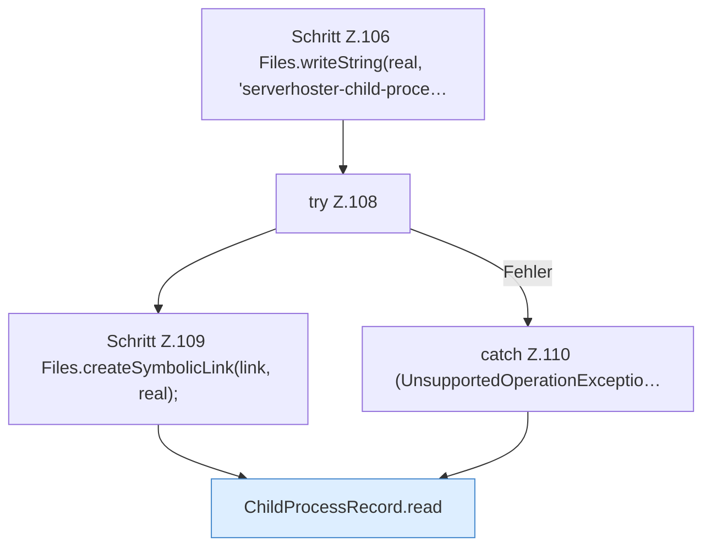

[[00 Start]] › [[Tests]] › [[LifecycleRobustnessTest]] › [[LifecycleRobustnessTest.Teil1]] › [[LifecycleRobustnessTest.symlinkRecordIsRejected]] › [[LifecycleRobustnessTest.symlinkRecordIsRejected.Teil1]]

# LifecycleRobustnessTest.symlinkRecordIsRejected.Teil1

- Fortsetzung von `LifecycleRobustnessTest.symlinkRecordIsRejected`, Quellreihenfolge.
