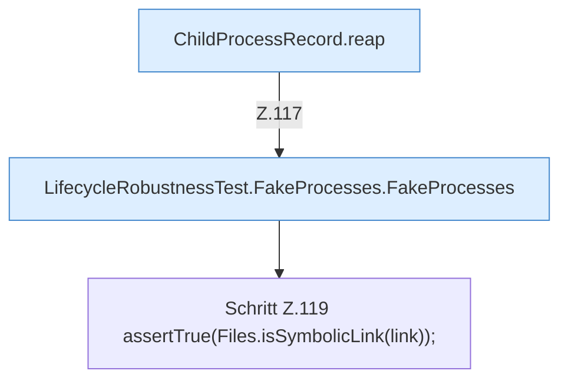

[[00 Start]] › [[Tests]] › [[LifecycleRobustnessTest]] › [[LifecycleRobustnessTest.Teil1]] › [[LifecycleRobustnessTest.symlinkRecordIsRejected]] › [[LifecycleRobustnessTest.symlinkRecordIsRejected.Teil2]]

# LifecycleRobustnessTest.symlinkRecordIsRejected.Teil2



```knoten
ChildProcessRecord.reap
  Dieser Teil räumt weg das. Räumt übrige [[Glossar#Prozess|Prozesse]] ab `reap`. Ruft `read`, `ours`, `waitUntilDead`.
LifecycleRobustnessTest.FakeProcesses.FakeProcesses
  Ein Schritt in einem [[Glossar#Probelauf|Probelauf]]. Er gehört nicht zum laufenden Server. `FakeProcesses` in `LifecycleRobustnessTest.java`. Nur Test.
Schritt Z.119 assertTrue(Files.isSymbolicLink(link));
  Zeile 119: Dateioperation. `assertTrue(Files.isSymbolicLink(link));`
```

> [!knoten]- Was die Blöcke tun
> - **ChildProcessRecord.reap**: Dieser Teil räumt weg das. Räumt übrige [[Glossar#Prozess|Prozesse]] ab `reap`. Ruft `read`, `ours`, `waitUntilDead`.
> - **LifecycleRobustnessTest.FakeProcesses.FakeProcesses**: Ein Schritt in einem [[Glossar#Probelauf|Probelauf]]. Er gehört nicht zum laufenden Server. `FakeProcesses` in `LifecycleRobustnessTest.java`. Nur Test.
> - **Schritt Z.119 assertTrue(Files.isSymbolicLink(link));**: Zeile 119: Dateioperation. `assertTrue(Files.isSymbolicLink(link));`

- Ein weiterer Abschnitt derselben Übersicht.
- Fortsetzung von `LifecycleRobustnessTest.symlinkRecordIsRejected`.
