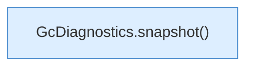

[[00 Start]] › [[Tests]] › [[LifecycleRobustnessTest]] › [[LifecycleRobustnessTest.Teil2]] › [[LifecycleRobustnessTest.telemetryKeepsHeapRssHostAndCgroupDistinctAndRotates]] › [[LifecycleRobustnessTest.telemetryKeepsHeapRssHostAndCgroupDistinctAndRotates.Teil2]]

# LifecycleRobustnessTest.telemetryKeepsHeapRssHostAndCgroupDistinctAndRotates.Teil2



```knoten
GcDiagnostics.snapshot()
  `snapshot` in `GcDiagnostics.java`. Ruft `snapshot`.
```

- Fortsetzung von `LifecycleRobustnessTest.telemetryKeepsHeapRssHostAndCgroupDistinctAndRotates`, Quellreihenfolge.
