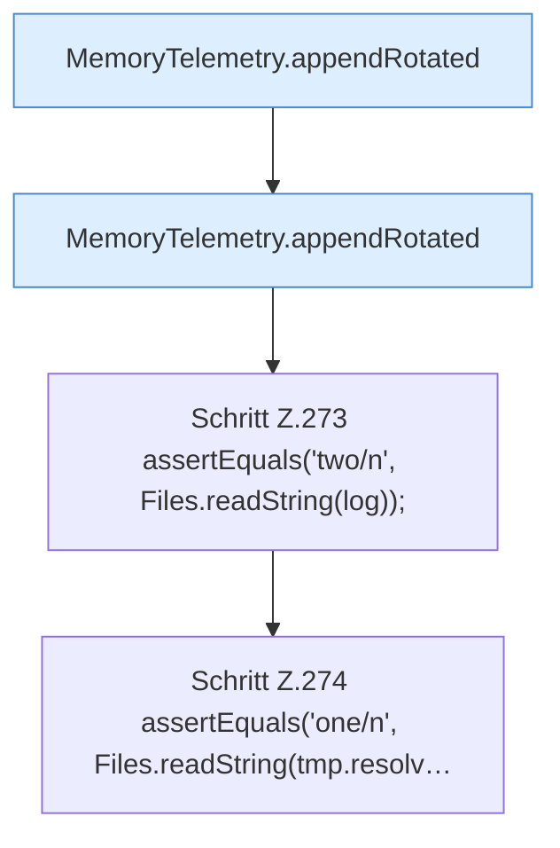

[[00 Start]] › [[Tests]] › [[LifecycleRobustnessTest]] › [[LifecycleRobustnessTest.Teil2]] › [[LifecycleRobustnessTest.telemetryKeepsHeapRssHostAndCgroupDistinctAndRotates]] › [[LifecycleRobustnessTest.telemetryKeepsHeapRssHostAndCgroupDistinctAndRotates.Teil3]]

# LifecycleRobustnessTest.telemetryKeepsHeapRssHostAndCgroupDistinctAndRotates.Teil3



```knoten
MemoryTelemetry.appendRotated
  Hängt an `appendRotated`.
Schritt Z.273 assertEquals('two/n', Files.readString(log));
  Zeile 273: liest Text aus einer Datei. `assertEquals('two/n', Files.readString(log));`
Schritt Z.274 assertEquals('one/n', Files.readString(tmp.resolv…
  Zeile 274: liest Text aus einer Datei. `assertEquals('one/n', Files.readString(tmp.resolv…`
```

- Fortsetzung von `LifecycleRobustnessTest.telemetryKeepsHeapRssHostAndCgroupDistinctAndRotates`, Quellreihenfolge.
