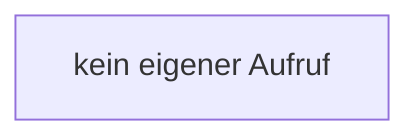

[[00 Start]] › [[Tests]] › [[LifecycleTestProcess]] › [[LifecycleTestProcess.LifecycleTestProcess]]

# LifecycleTestProcess.LifecycleTestProcess

`LifecycleTestProcess.LifecycleTestProcess()` [src/test/java/de/aichele/childlauncher/LifecycleTestProcess.java:8–8](https://github.com/Sciddie/minecraft-serverhoster-plugin/blob/95b02b953b0b4c23673e900e021a7c3c844aa37d/src/test/java/de/aichele/childlauncher/LifecycleTestProcess.java#L8-L8)



```knoten
kein eigener Aufruf
  Dieser Abschnitt ruft keine weitere eigene [[Glossar#Funktion|Funktion]] auf.
```

> [!knoten]- Was die Blöcke tun
> - **kein eigener Aufruf**: Dieser Abschnitt ruft keine weitere eigene [[Glossar#Funktion|Funktion]] auf.

- Ein Schritt in einem [[Glossar#Probelauf|Probelauf]]. Er gehört nicht zum laufenden Server.
- Das ist ein Probelauf, kein Teil des laufenden Servers.
