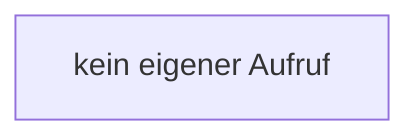

[[00 Start]] › [[Tests]] › [[LifecycleTestProcess]] › [[LifecycleTestProcess.LifecycleTestProcess]]

# LifecycleTestProcess.LifecycleTestProcess

`LifecycleTestProcess.LifecycleTestProcess()` [src/test/java/de/aichele/childlauncher/LifecycleTestProcess.java:8–8](https://github.com/Sciddie/minecraft-serverhoster-plugin/blob/95b02b953b0b4c23673e900e021a7c3c844aa37d/src/test/java/de/aichele/childlauncher/LifecycleTestProcess.java#L8-L8)

- `LifecycleTestProcess` in `src/test/java/de/aichele/childlauncher/LifecycleTestProcess.java`
- Auslöser: Test
