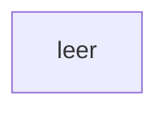

[[00 Start]] › [[Tests]] › [[LifecycleTestProcess]] › [[LifecycleTestProcess.main]] › [[LifecycleTestProcess.main.Z11.Case13]]

# LifecycleTestProcess.main.Z11.Case13



```knoten
leer
  Keine weiteren Knoten.
```

> [!knoten]- Was die Blöcke tun
> - **leer**: Keine weiteren Knoten.

- Das Innere eines Wegs, ab [[Glossar#Zeile|Zeile]] 13.
- Fortsetzung von `LifecycleTestProcess.main.Z11`.
