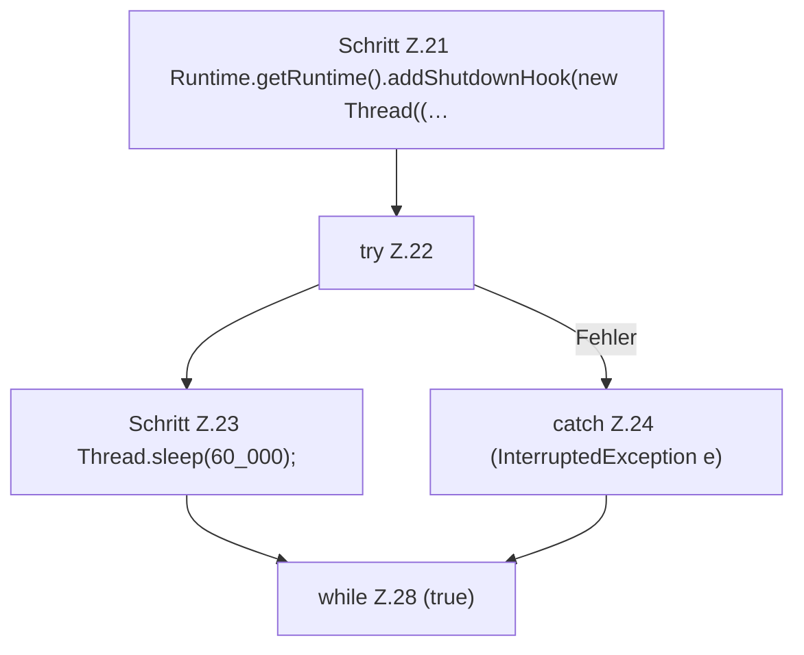

[[00 Start]] › [[Tests]] › [[LifecycleTestProcess]] › [[LifecycleTestProcess.main]] › [[LifecycleTestProcess.main.Z11.Case20]]

# LifecycleTestProcess.main.Z11.Case20

- Fortsetzung von `LifecycleTestProcess.main.Z11`, Quellreihenfolge.
