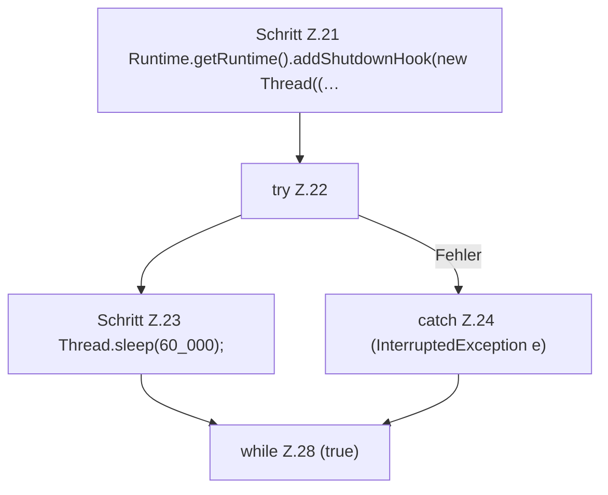

[[00 Start]] › [[Tests]] › [[LifecycleTestProcess]] › [[LifecycleTestProcess.main]] › [[LifecycleTestProcess.main.Z11.Case20]]

# LifecycleTestProcess.main.Z11.Case20



```knoten
Schritt Z.21 Runtime.getRuntime().addShutdownHook(new Thread((…
  Zeile 21: fragt die JVM-Laufzeit. `Runtime.getRuntime().addShutdownHook(new Thread((…`
try Z.22
  Zeile 22: Versuch. Der Fehlerpfad geht in catch.
Schritt Z.23 Thread.sleep(60_000);
  Zeile 23: wartet. `Thread.sleep(60_000);`
catch Z.24 (InterruptedException e)
  Zeile 24: fängt (InterruptedException e).
while Z.28 (true)
  Zeile 28: Schleife `(true)`.
```

- Fortsetzung von `LifecycleTestProcess.main.Z11`, Quellreihenfolge.
