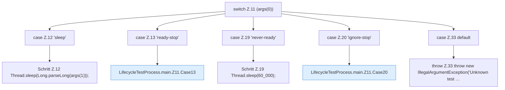

[[00 Start]] › [[Tests]] › [[LifecycleTestProcess]] › [[LifecycleTestProcess.main]] › [[LifecycleTestProcess.main.Z11]]

# LifecycleTestProcess.main.Z11

- Fortsetzung von `LifecycleTestProcess.main`, Quellreihenfolge.
