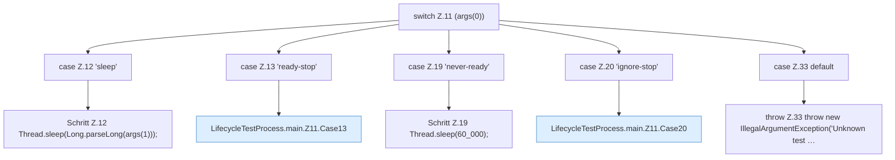

[[00 Start]] › [[Tests]] › [[LifecycleTestProcess]] › [[LifecycleTestProcess.main]] › [[LifecycleTestProcess.main.Z11]]

# LifecycleTestProcess.main.Z11



```knoten
switch Z.11 (args(0))
  Zeile 11: Verzweigung nach `(args(0))`.
case Z.12 'sleep'
  Zeile 12: Zweig `'sleep'`.
Schritt Z.12 Thread.sleep(Long.parseLong(args(1)));
  Zeile 12: wartet. `Thread.sleep(Long.parseLong(args(1)));`
case Z.13 'ready-stop'
  Zeile 13: Zweig `'ready-stop'`.
LifecycleTestProcess.main.Z11.Case13
  Das Innere eines Wegs, ab [[Glossar#Zeile|Zeile]] 13. Rumpf dieses switch-Zweigs ab Zeile 13.
case Z.19 'never-ready'
  Zeile 19: Zweig `'never-ready'`.
Schritt Z.19 Thread.sleep(60_000);
  Zeile 19: wartet. `Thread.sleep(60_000);`
case Z.20 'ignore-stop'
  Zeile 20: Zweig `'ignore-stop'`.
LifecycleTestProcess.main.Z11.Case20
  Das Innere eines Wegs, ab [[Glossar#Zeile|Zeile]] 20. Rumpf dieses switch-Zweigs ab Zeile 20.
case Z.33 default
  Zeile 33: Zweig `default`.
throw Z.33 throw new IllegalArgumentException('Unknown test …
  Zeile 33: Abbruch `throw new IllegalArgumentException('Unknown test …`.
```

> [!knoten]- Was die Blöcke tun
> - **switch Z.11 (args(0))**: Zeile 11: Verzweigung nach `(args(0))`.
> - **case Z.12 'sleep'**: Zeile 12: Zweig `'sleep'`.
> - **Schritt Z.12 Thread.sleep(Long.parseLong(args(1)));**: Zeile 12: wartet. `Thread.sleep(Long.parseLong(args(1)));`
> - **case Z.13 'ready-stop'**: Zeile 13: Zweig `'ready-stop'`.
> - **LifecycleTestProcess.main.Z11.Case13**: Das Innere eines Wegs, ab [[Glossar#Zeile|Zeile]] 13. Rumpf dieses switch-Zweigs ab Zeile 13.
> - **case Z.19 'never-ready'**: Zeile 19: Zweig `'never-ready'`.
> - **Schritt Z.19 Thread.sleep(60_000);**: Zeile 19: wartet. `Thread.sleep(60_000);`
> - **case Z.20 'ignore-stop'**: Zeile 20: Zweig `'ignore-stop'`.
> - **LifecycleTestProcess.main.Z11.Case20**: Das Innere eines Wegs, ab [[Glossar#Zeile|Zeile]] 20. Rumpf dieses switch-Zweigs ab Zeile 20.
> - **case Z.33 default**: Zeile 33: Zweig `default`.
> - **throw Z.33 throw new IllegalArgumentException('Unknown test …**: Zeile 33: Abbruch `throw new IllegalArgumentException('Unknown test …`.

- Der Ablauf geht in [[Glossar#Zeile|Zeile]] 11 weiter. Eine Ebene tiefer steht er genauer.
- Fortsetzung von `LifecycleTestProcess.main`.
