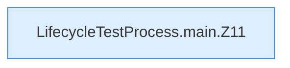

[[00 Start]] › [[Tests]] › [[LifecycleTestProcess]] › [[LifecycleTestProcess.main]]

# LifecycleTestProcess.main

`LifecycleTestProcess.main(String[] args)` [src/test/java/de/aichele/childlauncher/LifecycleTestProcess.java:10–35](https://github.com/Sciddie/minecraft-serverhoster-plugin/blob/95b02b953b0b4c23673e900e021a7c3c844aa37d/src/test/java/de/aichele/childlauncher/LifecycleTestProcess.java#L10-L35)

- `main` in `src/test/java/de/aichele/childlauncher/LifecycleTestProcess.java`
- Auslöser: Test
