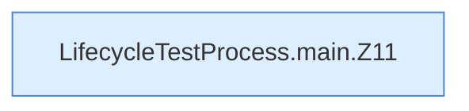

[[00 Start]] › [[Tests]] › [[LifecycleTestProcess]] › [[LifecycleTestProcess.main]]

# LifecycleTestProcess.main

`LifecycleTestProcess.main(String[] args)` [src/test/java/de/aichele/childlauncher/LifecycleTestProcess.java:10–35](https://github.com/Sciddie/minecraft-serverhoster-plugin/blob/95b02b953b0b4c23673e900e021a7c3c844aa37d/src/test/java/de/aichele/childlauncher/LifecycleTestProcess.java#L10-L35)



```knoten
LifecycleTestProcess.main.Z11
  Der Ablauf geht in [[Glossar#Zeile|Zeile]] 11 weiter. Eine Ebene tiefer steht er genauer. Im [[Glossar#Quelltext|Quelltext]] heißt das `Z11`.
```

> [!knoten]- Was die Blöcke tun
> - **LifecycleTestProcess.main.Z11**: Der Ablauf geht in [[Glossar#Zeile|Zeile]] 11 weiter. Eine Ebene tiefer steht er genauer. Im [[Glossar#Quelltext|Quelltext]] heißt das `Z11`.

- Ein Schritt in einem [[Glossar#Probelauf|Probelauf]]. Er gehört nicht zum laufenden Server.
- Das ist ein Probelauf, kein Teil des laufenden Servers.
