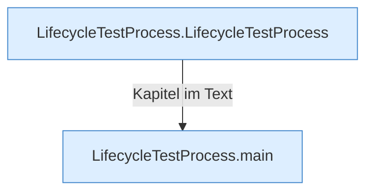

[[00 Start]] › [[Tests]] › [[LifecycleTestProcess]]

# LifecycleTestProcess



```knoten
LifecycleTestProcess.LifecycleTestProcess
  Ein Schritt in einem [[Glossar#Probelauf|Probelauf]]. Er gehört nicht zum laufenden Server.
LifecycleTestProcess.main
  Ein Schritt in einem [[Glossar#Probelauf|Probelauf]]. Er gehört nicht zum laufenden Server.
```

> [!knoten] Was die Blöcke tun
> - **LifecycleTestProcess.LifecycleTestProcess**: Ein Schritt in einem [[Glossar#Probelauf|Probelauf]]. Er gehört nicht zum laufenden Server.
> - **LifecycleTestProcess.main**: Ein Schritt in einem [[Glossar#Probelauf|Probelauf]]. Er gehört nicht zum laufenden Server.

- Ein Ersatz-Programm für Probeläufe, das einen [[Glossar#Spielserver|Spielserver]] spielt.
