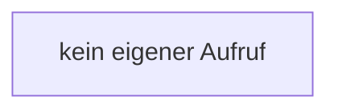

[[00 Start]] › [[Dashboard-HTTP]] › [[HTTP-Klassen]] › [[LogQuery]] › [[LogQuery.LogQuery]]

# LogQuery.LogQuery

`LogQuery.LogQuery()` [src/main/java/de/aichele/childlauncher/LogQuery.java:20–20](https://github.com/Sciddie/minecraft-serverhoster-plugin/blob/95b02b953b0b4c23673e900e021a7c3c844aa37d/src/main/java/de/aichele/childlauncher/LogQuery.java#L20-L20)



```knoten
kein eigener Aufruf
  In diesem Stück gibt es keinen weiteren eigenen Aufruf.
```

> [!knoten]- Was die Blöcke tun
> - **kein eigener Aufruf**: In diesem Stück gibt es keinen weiteren eigenen Aufruf.

- Dieser Teil fragt ab das.
- `LogQuery` in `src/main/java/de/aichele/childlauncher/LogQuery.java`
