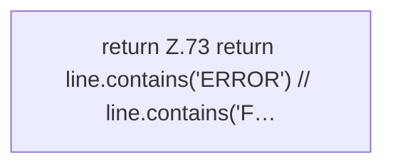

[[00 Start]] › [[Dashboard-HTTP]] › [[HTTP-Klassen]] › [[LogQuery]] › [[LogQuery.isError]]

# LogQuery.isError

`LogQuery.isError(String line)` [src/main/java/de/aichele/childlauncher/LogQuery.java:73–73](https://github.com/Sciddie/minecraft-serverhoster-plugin/blob/95b02b953b0b4c23673e900e021a7c3c844aa37d/src/main/java/de/aichele/childlauncher/LogQuery.java#L73-L73)



```knoten
return Z.73 return line.contains('ERROR') // line.contains('F…
  Zeile 73: Rückgabe `return line.contains('ERROR') // line.contains('F…`.
```

- `isError` in `src/main/java/de/aichele/childlauncher/LogQuery.java`
