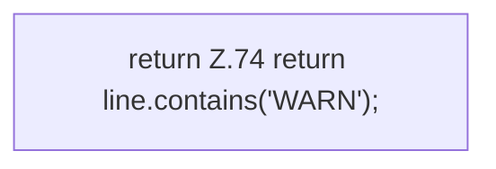

[[00 Start]] › [[Dashboard-HTTP]] › [[HTTP-Klassen]] › [[LogQuery]] › [[LogQuery.isWarn]]

# LogQuery.isWarn

`LogQuery.isWarn(String line)` [src/main/java/de/aichele/childlauncher/LogQuery.java:74–74](https://github.com/Sciddie/minecraft-serverhoster-plugin/blob/95b02b953b0b4c23673e900e021a7c3c844aa37d/src/main/java/de/aichele/childlauncher/LogQuery.java#L74-L74)



```knoten
return Z.74 return line.contains('WARN');
  Zeile 74: Rückgabe `return line.contains('WARN');`.
```

- `isWarn` in `src/main/java/de/aichele/childlauncher/LogQuery.java`
