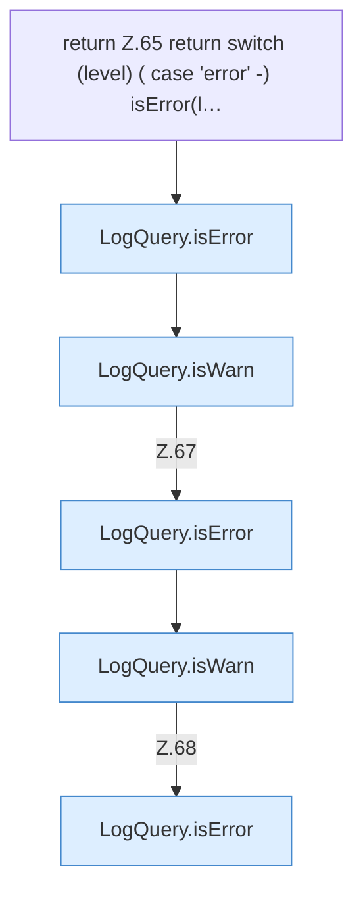

[[00 Start]] › [[Dashboard-HTTP]] › [[HTTP-Klassen]] › [[LogQuery]] › [[LogQuery.levelOk]] › [[LogQuery.levelOk.Z65]]

# LogQuery.levelOk.Z65



```knoten
return Z.65 return switch (level) ( case 'error' -) isError(l…
  Zeile 65: Rückgabe `return switch (level) ( case 'error' -) isError(l…`.
LogQuery.isError
  Dieser Teil prüft hier einen Schritt. Eine Ebene tiefer steht er genauer. Prüft `isError`.
LogQuery.isWarn
  Dieser Teil prüft die Warnung. Prüft `isWarn`.
```

> [!knoten]- Was die Blöcke tun
> - **return Z.65 return switch (level) ( case 'error' -) isError(l…**: Zeile 65: Rückgabe `return switch (level) ( case 'error' -) isError(l…`.
> - **LogQuery.isError**: Dieser Teil prüft hier einen Schritt. Eine Ebene tiefer steht er genauer. Prüft `isError`.
> - **LogQuery.isWarn**: Dieser Teil prüft die Warnung. Prüft `isWarn`.

- Der Ablauf geht in [[Glossar#Zeile|Zeile]] 65 weiter. Eine Ebene tiefer steht er genauer.
- Fortsetzung von `LogQuery.levelOk`.
