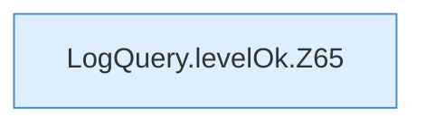

[[00 Start]] › [[Dashboard-HTTP]] › [[HTTP-Klassen]] › [[LogQuery]] › [[LogQuery.levelOk]]

# LogQuery.levelOk

`LogQuery.levelOk(String line, String level)` [src/main/java/de/aichele/childlauncher/LogQuery.java:64–71](https://github.com/Sciddie/minecraft-serverhoster-plugin/blob/95b02b953b0b4c23673e900e021a7c3c844aa37d/src/main/java/de/aichele/childlauncher/LogQuery.java#L64-L71)



```knoten
LogQuery.levelOk.Z65
  Fortsetzung des Ablaufs ab Zeile 65.
```

- `levelOk` in `src/main/java/de/aichele/childlauncher/LogQuery.java`
