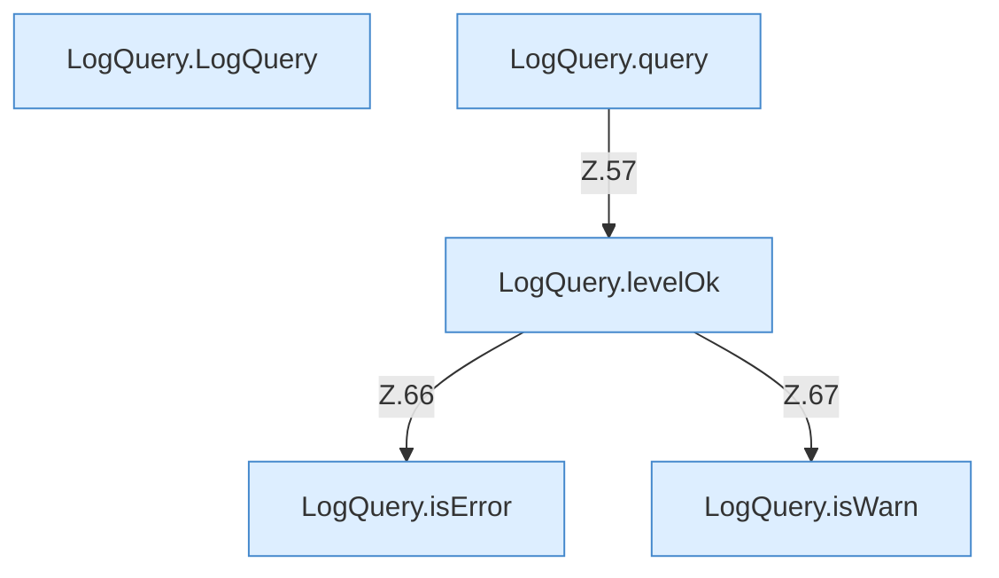

[[00 Start]] › [[Dashboard-HTTP]] › [[HTTP-Klassen]] › [[LogQuery]]

# LogQuery



```knoten
LogQuery.LogQuery
  Dieser Teil fragt ab das. Im [[Glossar#Quelltext|Quelltext]] heißt das `LogQuery`.
LogQuery.query
  Dieser Teil fragt ab das. Im [[Glossar#Quelltext|Quelltext]] heißt das `query`.
LogQuery.levelOk
  Dieser Teil macht hier einen einzelnen Schritt. Eine Ebene tiefer steht er genauer. Im [[Glossar#Quelltext|Quelltext]] heißt das `levelOk`.
LogQuery.isError
  Dieser Teil prüft hier einen Schritt. Eine Ebene tiefer steht er genauer. Im [[Glossar#Quelltext|Quelltext]] heißt das `isError`.
LogQuery.isWarn
  Dieser Teil prüft die Warnung. Im [[Glossar#Quelltext|Quelltext]] heißt das `isWarn`.
```

> [!knoten]- Was die Blöcke tun
> - **LogQuery.LogQuery**: Dieser Teil fragt ab das. Im [[Glossar#Quelltext|Quelltext]] heißt das `LogQuery`.
> - **LogQuery.query**: Dieser Teil fragt ab das. Im [[Glossar#Quelltext|Quelltext]] heißt das `query`.
> - **LogQuery.levelOk**: Dieser Teil macht hier einen einzelnen Schritt. Eine Ebene tiefer steht er genauer. Im [[Glossar#Quelltext|Quelltext]] heißt das `levelOk`.
> - **LogQuery.isError**: Dieser Teil prüft hier einen Schritt. Eine Ebene tiefer steht er genauer. Im [[Glossar#Quelltext|Quelltext]] heißt das `isError`.
> - **LogQuery.isWarn**: Dieser Teil prüft die Warnung. Im [[Glossar#Quelltext|Quelltext]] heißt das `isWarn`.

- Sucht [[Glossar#Zeile|Zeilen]] im Protokoll, die zu einer Frage passen.
