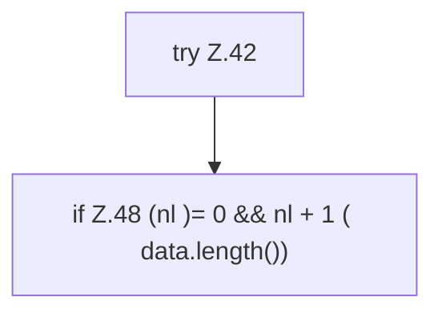

[[00 Start]] › [[Dashboard-HTTP]] › [[HTTP-Klassen]] › [[LogQuery]] › [[LogQuery.query]] › [[LogQuery.query.Teil1.Z31.Z40.Z42]]

# LogQuery.query.Teil1.Z31.Z40.Z42



```knoten
try Z.42
  Zeile 42: Versuch. Der Fehlerpfad geht in catch.
if Z.48 (nl )= 0 && nl + 1 ( data.length())
  Zeile 48: prüft `(nl )= 0 && nl + 1 ( data.length())`.
```

- Fortsetzung von `LogQuery.query.Teil1.Z31.Z40`, Quellreihenfolge.
