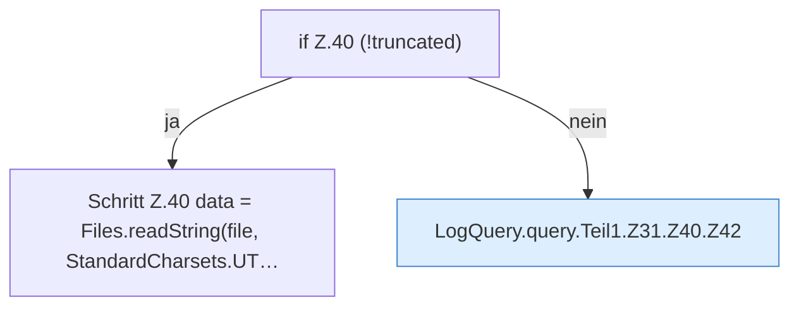

[[00 Start]] › [[Dashboard-HTTP]] › [[HTTP-Klassen]] › [[LogQuery]] › [[LogQuery.query]] › [[LogQuery.query.Teil1.Z31.Z40]]

# LogQuery.query.Teil1.Z31.Z40



```knoten
if Z.40 (!truncated)
  Zeile 40: prüft `(!truncated)`.
Schritt Z.40 data = Files.readString(file, StandardCharsets.UT…
  Zeile 40: liest Text aus einer Datei. `data = Files.readString(file, StandardCharsets.UT…`
LogQuery.query.Teil1.Z31.Z40.Z42
  Der Ablauf geht in [[Glossar#Zeile|Zeile]] 42 weiter. Eine Ebene tiefer steht er genauer. Fortsetzung des Ablaufs ab Zeile 42.
```

> [!knoten]- Was die Blöcke tun
> - **if Z.40 (!truncated)**: Zeile 40: prüft `(!truncated)`.
> - **Schritt Z.40 data = Files.readString(file, StandardCharsets.UT…**: Zeile 40: liest Text aus einer Datei. `data = Files.readString(file, StandardCharsets.UT…`
> - **LogQuery.query.Teil1.Z31.Z40.Z42**: Der Ablauf geht in [[Glossar#Zeile|Zeile]] 42 weiter. Eine Ebene tiefer steht er genauer. Fortsetzung des Ablaufs ab Zeile 42.

- Der Ablauf geht in [[Glossar#Zeile|Zeile]] 40 weiter. Eine Ebene tiefer steht er genauer.
- Fortsetzung von `LogQuery.query.Teil1.Z31`.
