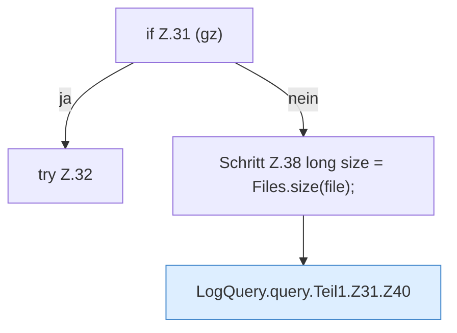

[[00 Start]] › [[Dashboard-HTTP]] › [[HTTP-Klassen]] › [[LogQuery]] › [[LogQuery.query]] › [[LogQuery.query.Teil1.Z31]]

# LogQuery.query.Teil1.Z31



```knoten
if Z.31 (gz)
  Zeile 31: prüft `(gz)`.
try Z.32
  Zeile 32: Versuch. Der Fehlerpfad geht in catch.
Schritt Z.38 long size = Files.size(file);
  Zeile 38: Dateioperation. `long size = Files.size(file);`
LogQuery.query.Teil1.Z31.Z40
  Der Ablauf geht in [[Glossar#Zeile|Zeile]] 40 weiter. Eine Ebene tiefer steht er genauer. Fortsetzung des Ablaufs ab Zeile 40.
```

> [!knoten]- Was die Blöcke tun
> - **if Z.31 (gz)**: Zeile 31: prüft `(gz)`.
> - **try Z.32**: Zeile 32: Versuch. Der Fehlerpfad geht in catch.
> - **Schritt Z.38 long size = Files.size(file);**: Zeile 38: Dateioperation. `long size = Files.size(file);`
> - **LogQuery.query.Teil1.Z31.Z40**: Der Ablauf geht in [[Glossar#Zeile|Zeile]] 40 weiter. Eine Ebene tiefer steht er genauer. Fortsetzung des Ablaufs ab Zeile 40.

- Der Ablauf geht in [[Glossar#Zeile|Zeile]] 31 weiter. Eine Ebene tiefer steht er genauer.
- Fortsetzung von `LogQuery.query.Teil1`.
