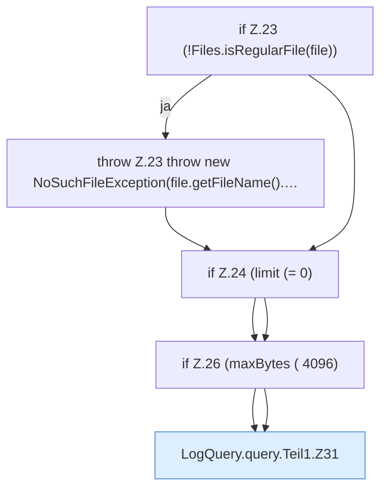

[[00 Start]] › [[Dashboard-HTTP]] › [[HTTP-Klassen]] › [[LogQuery]] › [[LogQuery.query]] › [[LogQuery.query.Teil1]]

# LogQuery.query.Teil1



```knoten
if Z.23 (!Files.isRegularFile(file))
  Zeile 23: prüft `(!Files.isRegularFile(file))`.
throw Z.23 throw new NoSuchFileException(file.getFileName().…
  Zeile 23: Abbruch `throw new NoSuchFileException(file.getFileName().…`.
if Z.24 (limit (= 0)
  Zeile 24: prüft `(limit (= 0)`.
if Z.26 (maxBytes ( 4096)
  Zeile 26: prüft `(maxBytes ( 4096)`.
LogQuery.query.Teil1.Z31
  Der Ablauf geht in [[Glossar#Zeile|Zeile]] 31 weiter. Eine Ebene tiefer steht er genauer. Fortsetzung des Ablaufs ab Zeile 31.
```

> [!knoten]- Was die Blöcke tun
> - **if Z.23 (!Files.isRegularFile(file))**: Zeile 23: prüft `(!Files.isRegularFile(file))`.
> - **throw Z.23 throw new NoSuchFileException(file.getFileName().…**: Zeile 23: Abbruch `throw new NoSuchFileException(file.getFileName().…`.
> - **if Z.24 (limit (= 0)**: Zeile 24: prüft `(limit (= 0)`.
> - **if Z.26 (maxBytes ( 4096)**: Zeile 26: prüft `(maxBytes ( 4096)`.
> - **LogQuery.query.Teil1.Z31**: Der Ablauf geht in [[Glossar#Zeile|Zeile]] 31 weiter. Eine Ebene tiefer steht er genauer. Fortsetzung des Ablaufs ab Zeile 31.

- Ein weiterer Abschnitt derselben Übersicht.
- Fortsetzung von `LogQuery.query`.
