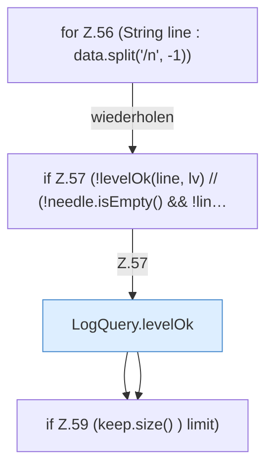

[[00 Start]] › [[Dashboard-HTTP]] › [[HTTP-Klassen]] › [[LogQuery]] › [[LogQuery.query]] › [[LogQuery.query.Teil2.Z56]]

# LogQuery.query.Teil2.Z56

- Fortsetzung von `LogQuery.query.Teil2`, Quellreihenfolge.
