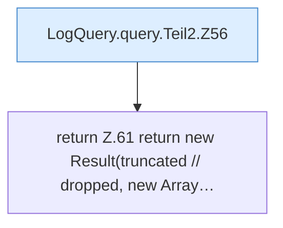

[[00 Start]] › [[Dashboard-HTTP]] › [[HTTP-Klassen]] › [[LogQuery]] › [[LogQuery.query]] › [[LogQuery.query.Teil2]]

# LogQuery.query.Teil2



```knoten
LogQuery.query.Teil2.Z56
  Der Ablauf geht in [[Glossar#Zeile|Zeile]] 56 weiter. Eine Ebene tiefer steht er genauer. Fortsetzung des Ablaufs ab Zeile 56.
return Z.61 return new Result(truncated // dropped, new Array…
  Zeile 61: Rückgabe `return new Result(truncated // dropped, new Array…`.
```

> [!knoten]- Was die Blöcke tun
> - **LogQuery.query.Teil2.Z56**: Der Ablauf geht in [[Glossar#Zeile|Zeile]] 56 weiter. Eine Ebene tiefer steht er genauer. Fortsetzung des Ablaufs ab Zeile 56.
> - **return Z.61 return new Result(truncated // dropped, new Array…**: Zeile 61: Rückgabe `return new Result(truncated // dropped, new Array…`.

- Ein weiterer Abschnitt derselben Übersicht.
- Fortsetzung von `LogQuery.query`.
