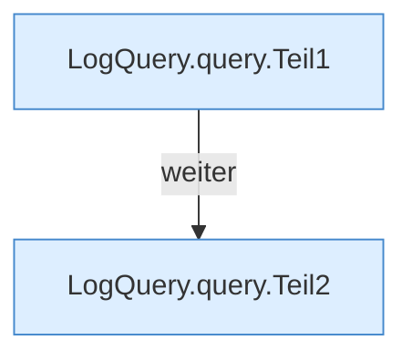

[[00 Start]] › [[Dashboard-HTTP]] › [[HTTP-Klassen]] › [[LogQuery]] › [[LogQuery.query]]

# LogQuery.query

`LogQuery.query(Path file, String level, String text, int limit, int maxBytes)` [src/main/java/de/aichele/childlauncher/LogQuery.java:22–62](https://github.com/Sciddie/minecraft-serverhoster-plugin/blob/95b02b953b0b4c23673e900e021a7c3c844aa37d/src/main/java/de/aichele/childlauncher/LogQuery.java#L22-L62)



```knoten
LogQuery.query.Teil1
  Abschnitt 1 dieses Ablaufs, in Quellreihenfolge.
LogQuery.query.Teil2
  Abschnitt 2 dieses Ablaufs, in Quellreihenfolge.
```

- `query` in `src/main/java/de/aichele/childlauncher/LogQuery.java`
