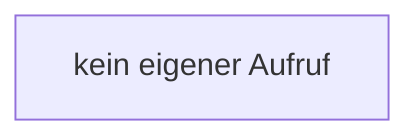

[[00 Start]] › [[Host-Betrieb]] › [[Speicher-Messung]] › [[MemoryIncidentReport]] › [[MemoryIncidentReport.MemoryIncidentReport]]

# MemoryIncidentReport.MemoryIncidentReport

`MemoryIncidentReport.MemoryIncidentReport()` [src/main/java/de/aichele/childlauncher/MemoryIncidentReport.java:20–20](https://github.com/Sciddie/minecraft-serverhoster-plugin/blob/95b02b953b0b4c23673e900e021a7c3c844aa37d/src/main/java/de/aichele/childlauncher/MemoryIncidentReport.java#L20-L20)

- `MemoryIncidentReport` in `src/main/java/de/aichele/childlauncher/MemoryIncidentReport.java`
