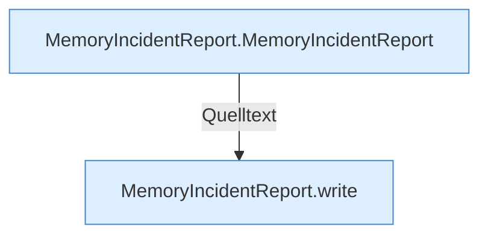

[[00 Start]] › [[Host-Betrieb]] › [[Speicher-Messung]] › [[MemoryIncidentReport]]

# MemoryIncidentReport



```knoten
MemoryIncidentReport.MemoryIncidentReport
  Betrifft den Speicher `MemoryIncidentReport`.
MemoryIncidentReport.write
  Schreibt `write`. Ruft `cgroupUsePercent`.
```


