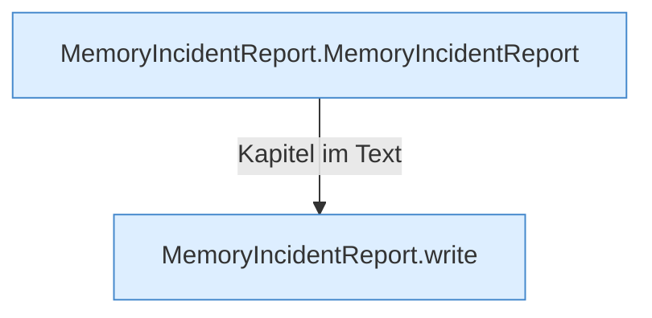

[[00 Start]] › [[Host-Betrieb]] › [[Speicher-Messung]] › [[MemoryIncidentReport]]

# MemoryIncidentReport



```knoten
MemoryIncidentReport.MemoryIncidentReport
  Dieser Teil kümmert sich um den [[Glossar#Vorfall|Vorfall]] den Bericht. Im [[Glossar#Quelltext|Quelltext]] heißt das `MemoryIncidentReport`.
MemoryIncidentReport.write
  Dieser Teil schreibt das. Im [[Glossar#Quelltext|Quelltext]] heißt das `write`.
```

> [!knoten]- Was die Blöcke tun
> - **MemoryIncidentReport.MemoryIncidentReport**: Dieser Teil kümmert sich um den [[Glossar#Vorfall|Vorfall]] den Bericht. Im [[Glossar#Quelltext|Quelltext]] heißt das `MemoryIncidentReport`.
> - **MemoryIncidentReport.write**: Dieser Teil schreibt das. Im [[Glossar#Quelltext|Quelltext]] heißt das `write`.

- Schreibt den Text auf, wenn der [[Glossar#Arbeitsspeicher|Arbeitsspeicher]] knapp wurde.
