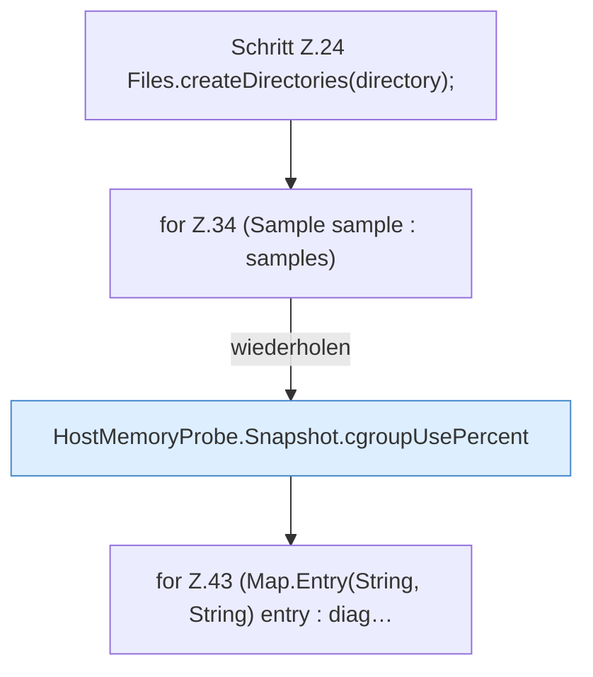

[[00 Start]] › [[Host-Betrieb]] › [[Speicher-Messung]] › [[MemoryIncidentReport]] › [[MemoryIncidentReport.write]] › [[MemoryIncidentReport.write.Teil1]]

# MemoryIncidentReport.write.Teil1



```knoten
Schritt Z.24 Files.createDirectories(directory);
  Zeile 24: Dateioperation. `Files.createDirectories(directory);`
for Z.34 (Sample sample : samples)
  Zeile 34: Schleife `(Sample sample : samples)`.
HostMemoryProbe.Snapshot.cgroupUsePercent
  Die Messung macht hier einen einzelnen Schritt. Eine Ebene tiefer steht er genauer. `cgroupUsePercent` in `HostMemoryProbe.java`.
for Z.43 (Map.Entry(String, String) entry : diag…
  Zeile 43: Schleife `(Map.Entry(String, String) entry : diag…`.
```

> [!knoten]- Was die Blöcke tun
> - **Schritt Z.24 Files.createDirectories(directory);**: Zeile 24: Dateioperation. `Files.createDirectories(directory);`
> - **for Z.34 (Sample sample : samples)**: Zeile 34: Schleife `(Sample sample : samples)`.
> - **HostMemoryProbe.Snapshot.cgroupUsePercent**: Die Messung macht hier einen einzelnen Schritt. Eine Ebene tiefer steht er genauer. `cgroupUsePercent` in `HostMemoryProbe.java`.
> - **for Z.43 (Map.Entry(String, String) entry : diag…**: Zeile 43: Schleife `(Map.Entry(String, String) entry : diag…`.

- Ein weiterer Abschnitt derselben Übersicht.
- Fortsetzung von `MemoryIncidentReport.write`.
