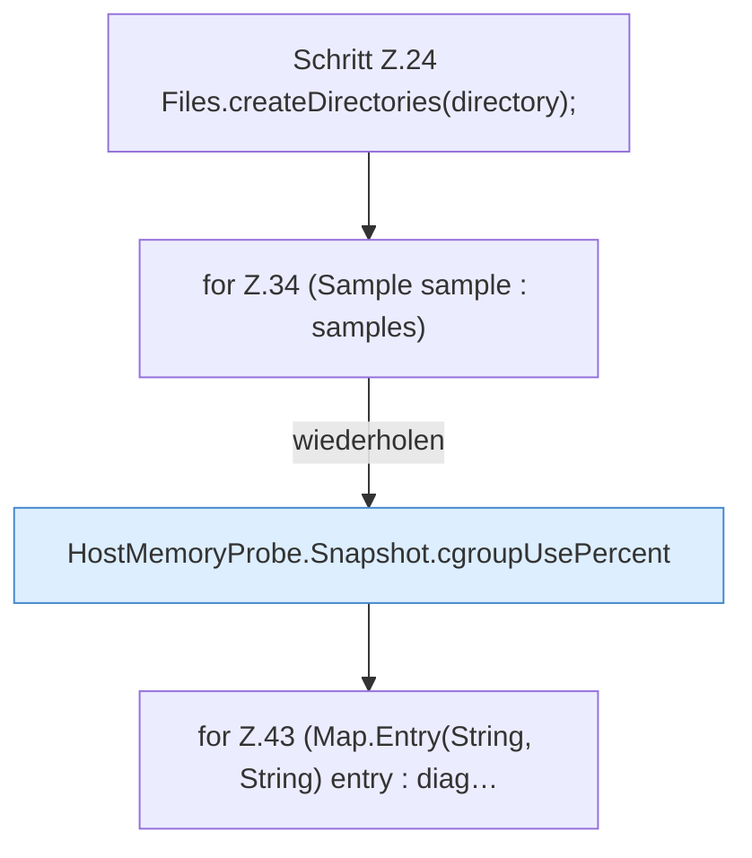

[[00 Start]] › [[Host-Betrieb]] › [[Speicher-Messung]] › [[MemoryIncidentReport]] › [[MemoryIncidentReport.write]] › [[MemoryIncidentReport.write.Teil1]]

# MemoryIncidentReport.write.Teil1

- Fortsetzung von `MemoryIncidentReport.write`, Quellreihenfolge.
