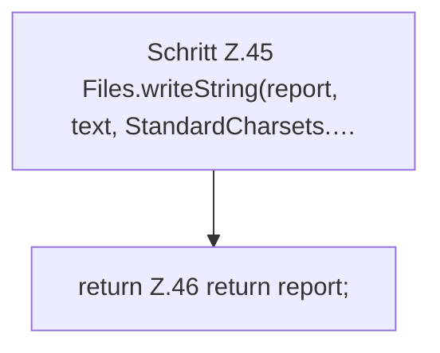

[[00 Start]] › [[Host-Betrieb]] › [[Speicher-Messung]] › [[MemoryIncidentReport]] › [[MemoryIncidentReport.write]] › [[MemoryIncidentReport.write.Teil2]]

# MemoryIncidentReport.write.Teil2



```knoten
Schritt Z.45 Files.writeString(report, text, StandardCharsets.…
  Zeile 45: schreibt Text in eine Datei. `Files.writeString(report, text, StandardCharsets.…`
return Z.46 return report;
  Zeile 46: Rückgabe `return report;`.
```

- Fortsetzung von `MemoryIncidentReport.write`, Quellreihenfolge.
