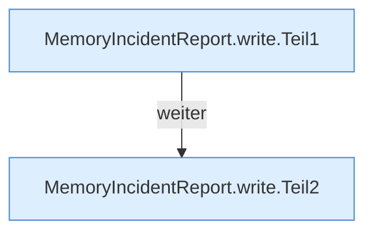

[[00 Start]] › [[Host-Betrieb]] › [[Speicher-Messung]] › [[MemoryIncidentReport]] › [[MemoryIncidentReport.write]]

# MemoryIncidentReport.write

`MemoryIncidentReport.write(Path directory, Instant createdAt, Map<String, String> facts, List<Sample> samples, Map<String, String> diagnostics)` [src/main/java/de/aichele/childlauncher/MemoryIncidentReport.java:22–47](https://github.com/Sciddie/minecraft-serverhoster-plugin/blob/95b02b953b0b4c23673e900e021a7c3c844aa37d/src/main/java/de/aichele/childlauncher/MemoryIncidentReport.java#L22-L47)



```knoten
MemoryIncidentReport.write.Teil1
  Ein weiterer Abschnitt derselben Übersicht. Abschnitt 1 dieses Ablaufs, in Quellreihenfolge.
MemoryIncidentReport.write.Teil2
  Ein weiterer Abschnitt derselben Übersicht. Abschnitt 2 dieses Ablaufs, in Quellreihenfolge.
```

> [!knoten]- Was die Blöcke tun
> - **MemoryIncidentReport.write.Teil1**: Ein weiterer Abschnitt derselben Übersicht. Abschnitt 1 dieses Ablaufs, in Quellreihenfolge.
> - **MemoryIncidentReport.write.Teil2**: Ein weiterer Abschnitt derselben Übersicht. Abschnitt 2 dieses Ablaufs, in Quellreihenfolge.

- Dieser Teil schreibt das.
- `write` in `src/main/java/de/aichele/childlauncher/MemoryIncidentReport.java`
