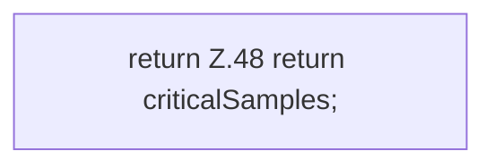

[[00 Start]] › [[Host-Betrieb]] › [[Speicher-Messung]] › [[MemoryProtectionPolicy]] › [[MemoryProtectionPolicy.criticalSamples]]

# MemoryProtectionPolicy.criticalSamples

`MemoryProtectionPolicy.criticalSamples()` [src/main/java/de/aichele/childlauncher/MemoryProtectionPolicy.java:47–49](https://github.com/Sciddie/minecraft-serverhoster-plugin/blob/95b02b953b0b4c23673e900e021a7c3c844aa37d/src/main/java/de/aichele/childlauncher/MemoryProtectionPolicy.java#L47-L49)



```knoten
return Z.48 return criticalSamples;
  Zeile 48: Rückgabe `return criticalSamples;`.
```

- `criticalSamples` in `src/main/java/de/aichele/childlauncher/MemoryProtectionPolicy.java`
