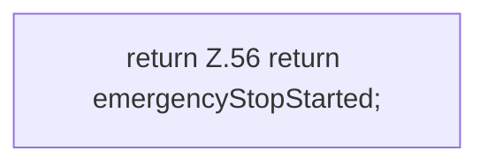

[[00 Start]] › [[Host-Betrieb]] › [[Speicher-Messung]] › [[MemoryProtectionPolicy]] › [[MemoryProtectionPolicy.emergencyStopStarted]]

# MemoryProtectionPolicy.emergencyStopStarted

`MemoryProtectionPolicy.emergencyStopStarted()` [src/main/java/de/aichele/childlauncher/MemoryProtectionPolicy.java:55–57](https://github.com/Sciddie/minecraft-serverhoster-plugin/blob/95b02b953b0b4c23673e900e021a7c3c844aa37d/src/main/java/de/aichele/childlauncher/MemoryProtectionPolicy.java#L55-L57)



```knoten
return Z.56 return emergencyStopStarted;
  Zeile 56: Rückgabe `return emergencyStopStarted;`.
```

> [!knoten]- Was die Blöcke tun
> - **return Z.56 return emergencyStopStarted;**: Zeile 56: Rückgabe `return emergencyStopStarted;`.

- Dieser Teil stoppt hier einen Schritt. Eine Ebene tiefer steht er genauer.
- `emergencyStopStarted` in `src/main/java/de/aichele/childlauncher/MemoryProtectionPolicy.java`
