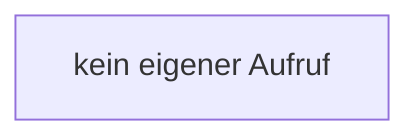

[[00 Start]] › [[Host-Betrieb]] › [[Speicher-Messung]] › [[MemoryProtectionPolicy]] › [[MemoryProtectionPolicy.finishRecovery]]

# MemoryProtectionPolicy.finishRecovery

`MemoryProtectionPolicy.finishRecovery()` [src/main/java/de/aichele/childlauncher/MemoryProtectionPolicy.java:63–65](https://github.com/Sciddie/minecraft-serverhoster-plugin/blob/95b02b953b0b4c23673e900e021a7c3c844aa37d/src/main/java/de/aichele/childlauncher/MemoryProtectionPolicy.java#L63-L65)

- `finishRecovery` in `src/main/java/de/aichele/childlauncher/MemoryProtectionPolicy.java`
