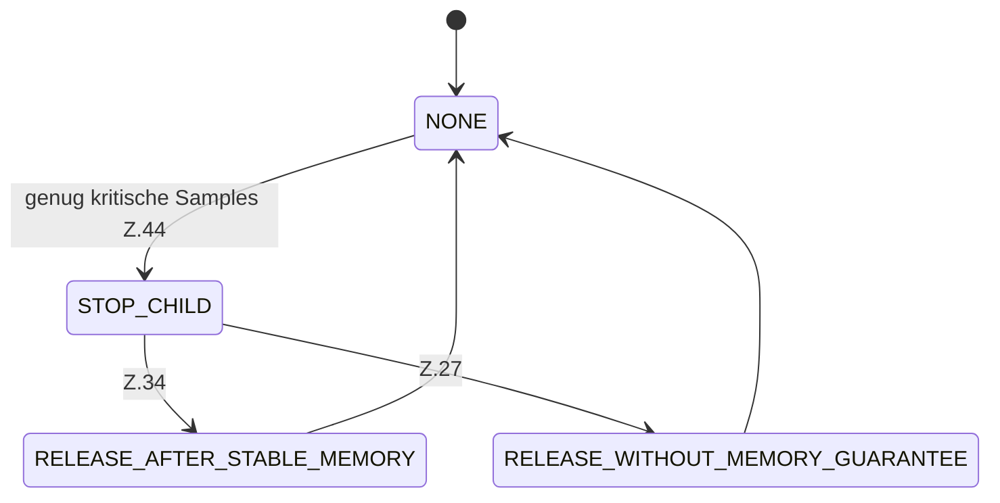

[[00 Start]] › [[Host-Betrieb]] › [[Speicher-Messung]] › [[MemoryProtectionPolicy]]

# MemoryProtectionPolicy


```knoten
MemoryProtectionPolicy.sample
  Dieser Teil misst das. Im [[Glossar#Quelltext|Quelltext]] heißt das `sample`.
MemoryProtectionPolicy.criticalSamples
  Dieser Teil macht hier einen einzelnen Schritt. Eine Ebene tiefer steht er genauer. Im [[Glossar#Quelltext|Quelltext]] heißt das `criticalSamples`.
MemoryProtectionPolicy.resetCriticalSamples
  Dieser Teil setzt zurück hier einen Schritt. Eine Ebene tiefer steht er genauer. Im [[Glossar#Quelltext|Quelltext]] heißt das `resetCriticalSamples`.
MemoryProtectionPolicy.emergencyStopStarted
  Dieser Teil stoppt hier einen Schritt. Eine Ebene tiefer steht er genauer. Im [[Glossar#Quelltext|Quelltext]] heißt das `emergencyStopStarted`.
MemoryProtectionPolicy.startEmergencyStop
  Dieser Teil startet den [[Glossar#Notstopp|Notstopp]] den [[Glossar#Stopp|Stopp]]. Im [[Glossar#Quelltext|Quelltext]] heißt das `startEmergencyStop`.
MemoryProtectionPolicy.finishRecovery
  Dieser Teil beendet die Wiederherstellung. Im [[Glossar#Quelltext|Quelltext]] heißt das `finishRecovery`.
```

> [!knoten]- Was die Blöcke tun
> - **MemoryProtectionPolicy.sample**: Dieser Teil misst das. Im [[Glossar#Quelltext|Quelltext]] heißt das `sample`.
> - **MemoryProtectionPolicy.criticalSamples**: Dieser Teil macht hier einen einzelnen Schritt. Eine Ebene tiefer steht er genauer. Im [[Glossar#Quelltext|Quelltext]] heißt das `criticalSamples`.
> - **MemoryProtectionPolicy.resetCriticalSamples**: Dieser Teil setzt zurück hier einen Schritt. Eine Ebene tiefer steht er genauer. Im [[Glossar#Quelltext|Quelltext]] heißt das `resetCriticalSamples`.
> - **MemoryProtectionPolicy.emergencyStopStarted**: Dieser Teil stoppt hier einen Schritt. Eine Ebene tiefer steht er genauer. Im [[Glossar#Quelltext|Quelltext]] heißt das `emergencyStopStarted`.
> - **MemoryProtectionPolicy.startEmergencyStop**: Dieser Teil startet den [[Glossar#Notstopp|Notstopp]] den [[Glossar#Stopp|Stopp]]. Im [[Glossar#Quelltext|Quelltext]] heißt das `startEmergencyStop`.
> - **MemoryProtectionPolicy.finishRecovery**: Dieser Teil beendet die Wiederherstellung. Im [[Glossar#Quelltext|Quelltext]] heißt das `finishRecovery`.



- Die Entscheidung bei Speichermangel: nichts tun, den [[Glossar#Spielserver|Spielserver]] stoppen, oder eine zuvor vergebene Reserve wieder freigeben.
