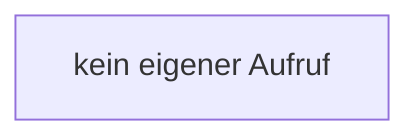

[[00 Start]] › [[Host-Betrieb]] › [[Speicher-Messung]] › [[MemoryProtectionPolicy]] › [[MemoryProtectionPolicy.resetCriticalSamples]]

# MemoryProtectionPolicy.resetCriticalSamples

`MemoryProtectionPolicy.resetCriticalSamples()` [src/main/java/de/aichele/childlauncher/MemoryProtectionPolicy.java:51–53](https://github.com/Sciddie/minecraft-serverhoster-plugin/blob/95b02b953b0b4c23673e900e021a7c3c844aa37d/src/main/java/de/aichele/childlauncher/MemoryProtectionPolicy.java#L51-L53)



```knoten
kein eigener Aufruf
  In diesem Stück gibt es keinen weiteren eigenen Aufruf.
```

- `resetCriticalSamples` in `src/main/java/de/aichele/childlauncher/MemoryProtectionPolicy.java`
