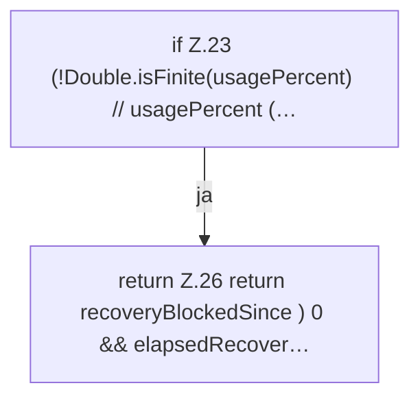

[[00 Start]] › [[Host-Betrieb]] › [[Speicher-Messung]] › [[MemoryProtectionPolicy]] › [[MemoryProtectionPolicy.sample]] › [[MemoryProtectionPolicy.sample.Teil1]]

# MemoryProtectionPolicy.sample.Teil1

- Fortsetzung von `MemoryProtectionPolicy.sample`, Quellreihenfolge.
