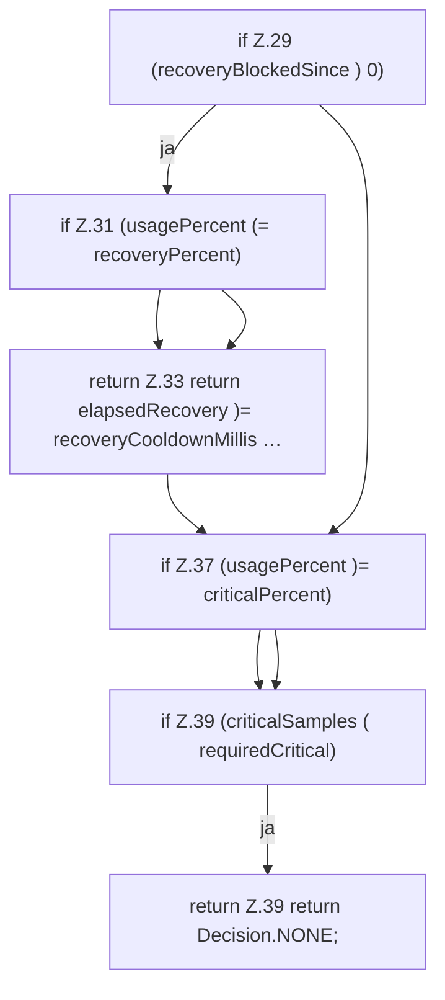

[[00 Start]] › [[Host-Betrieb]] › [[Speicher-Messung]] › [[MemoryProtectionPolicy]] › [[MemoryProtectionPolicy.sample]] › [[MemoryProtectionPolicy.sample.Teil2]]

# MemoryProtectionPolicy.sample.Teil2



```knoten
if Z.29 (recoveryBlockedSince ) 0)
  Zeile 29: prüft `(recoveryBlockedSince ) 0)`.
if Z.31 (usagePercent (= recoveryPercent)
  Zeile 31: prüft `(usagePercent (= recoveryPercent)`.
return Z.33 return elapsedRecovery )= recoveryCooldownMillis …
  Zeile 33: Rückgabe `return elapsedRecovery )= recoveryCooldownMillis …`.
if Z.37 (usagePercent )= criticalPercent)
  Zeile 37: prüft `(usagePercent )= criticalPercent)`.
if Z.39 (criticalSamples ( requiredCritical)
  Zeile 39: prüft `(criticalSamples ( requiredCritical)`.
return Z.39 return Decision.NONE;
  Zeile 39: Rückgabe `return Decision.NONE;`.
```

> [!knoten]- Was die Blöcke tun
> - **if Z.29 (recoveryBlockedSince ) 0)**: Zeile 29: prüft `(recoveryBlockedSince ) 0)`.
> - **if Z.31 (usagePercent (= recoveryPercent)**: Zeile 31: prüft `(usagePercent (= recoveryPercent)`.
> - **return Z.33 return elapsedRecovery )= recoveryCooldownMillis …**: Zeile 33: Rückgabe `return elapsedRecovery )= recoveryCooldownMillis …`.
> - **if Z.37 (usagePercent )= criticalPercent)**: Zeile 37: prüft `(usagePercent )= criticalPercent)`.
> - **if Z.39 (criticalSamples ( requiredCritical)**: Zeile 39: prüft `(criticalSamples ( requiredCritical)`.
> - **return Z.39 return Decision.NONE;**: Zeile 39: Rückgabe `return Decision.NONE;`.

- Ein weiterer Abschnitt derselben Übersicht.
- Fortsetzung von `MemoryProtectionPolicy.sample`.
