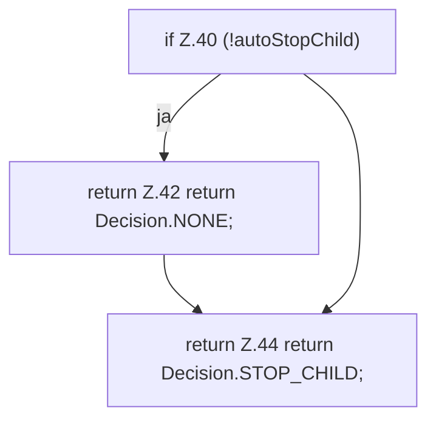

[[00 Start]] › [[Host-Betrieb]] › [[Speicher-Messung]] › [[MemoryProtectionPolicy]] › [[MemoryProtectionPolicy.sample]] › [[MemoryProtectionPolicy.sample.Teil3]]

# MemoryProtectionPolicy.sample.Teil3



```knoten
if Z.40 (!autoStopChild)
  Zeile 40: prüft `(!autoStopChild)`.
return Z.42 return Decision.NONE;
  Zeile 42: Rückgabe `return Decision.NONE;`.
return Z.44 return Decision.STOP_CHILD;
  Zeile 44: Rückgabe `return Decision.STOP_CHILD;`.
```

> [!knoten]- Was die Blöcke tun
> - **if Z.40 (!autoStopChild)**: Zeile 40: prüft `(!autoStopChild)`.
> - **return Z.42 return Decision.NONE;**: Zeile 42: Rückgabe `return Decision.NONE;`.
> - **return Z.44 return Decision.STOP_CHILD;**: Zeile 44: Rückgabe `return Decision.STOP_CHILD;`.

- Ein weiterer Abschnitt derselben Übersicht.
- Fortsetzung von `MemoryProtectionPolicy.sample`.
