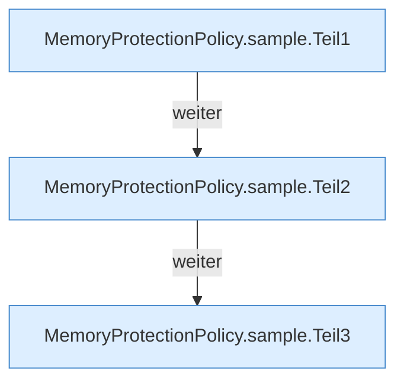

[[00 Start]] › [[Host-Betrieb]] › [[Speicher-Messung]] › [[MemoryProtectionPolicy]] › [[MemoryProtectionPolicy.sample]]

# MemoryProtectionPolicy.sample

`MemoryProtectionPolicy.sample(double usagePercent, double criticalPercent, double recoveryPercent, int requiredCriticalSamples, int requiredRecoverySamples, long recoveryBlockedSince, long now, long recoveryCooldownMillis, boolean autoStopChild)` [src/main/java/de/aichele/childlauncher/MemoryProtectionPolicy.java:15–45](https://github.com/Sciddie/minecraft-serverhoster-plugin/blob/95b02b953b0b4c23673e900e021a7c3c844aa37d/src/main/java/de/aichele/childlauncher/MemoryProtectionPolicy.java#L15-L45)



```knoten
MemoryProtectionPolicy.sample.Teil1
  Ein weiterer Abschnitt derselben Übersicht. Abschnitt 1 dieses Ablaufs, in Quellreihenfolge.
MemoryProtectionPolicy.sample.Teil2
  Ein weiterer Abschnitt derselben Übersicht. Abschnitt 2 dieses Ablaufs, in Quellreihenfolge.
MemoryProtectionPolicy.sample.Teil3
  Ein weiterer Abschnitt derselben Übersicht. Abschnitt 3 dieses Ablaufs, in Quellreihenfolge.
```

> [!knoten]- Was die Blöcke tun
> - **MemoryProtectionPolicy.sample.Teil1**: Ein weiterer Abschnitt derselben Übersicht. Abschnitt 1 dieses Ablaufs, in Quellreihenfolge.
> - **MemoryProtectionPolicy.sample.Teil2**: Ein weiterer Abschnitt derselben Übersicht. Abschnitt 2 dieses Ablaufs, in Quellreihenfolge.
> - **MemoryProtectionPolicy.sample.Teil3**: Ein weiterer Abschnitt derselben Übersicht. Abschnitt 3 dieses Ablaufs, in Quellreihenfolge.

- Dieser Teil misst das.
- `sample` in `src/main/java/de/aichele/childlauncher/MemoryProtectionPolicy.java`
